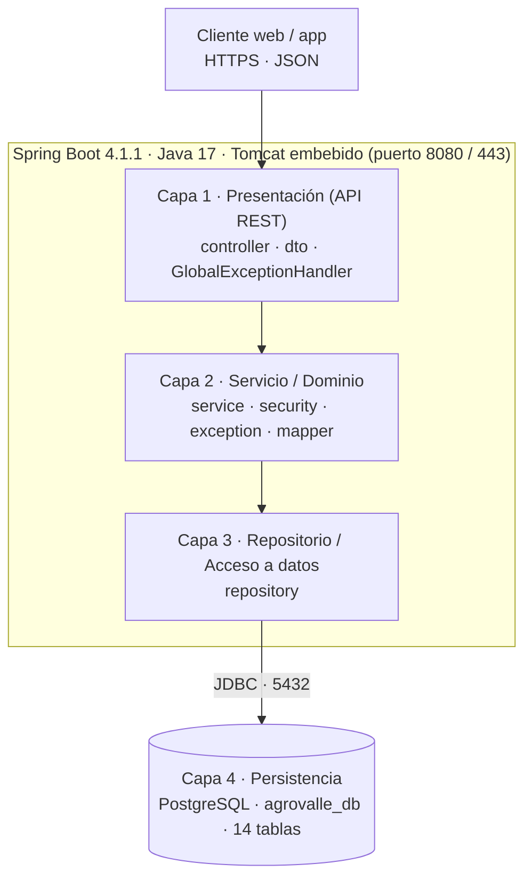

# Arquitectura de software — MVC en 4 capas, patrones GoF / Enterprise y principios SOLID

**AgroValle Connect · diseño para las 15 historias de usuario (HU-01 a HU-15)**

Stack: Java 17 · Spring Boot 4.1.1 (Tomcat embebido) · Spring Data JPA / Hibernate · Spring Security · PostgreSQL 15/16 o
superior. Paquete base: `com.agrovalle.connect`.

Documentos relacionados: `modelo-datos.md`, `schema.sql`, `diagrama-componentes.png`, `diagrama-despliegue.png` y los
cinco diagramas de secuencia (`diagrama-secuencia*.png`).

## 1. Visión general



Regla de dependencia: cada capa solo conoce a la inmediatamente inferior (`controller → service → repository →
PostgreSQL`). Un controlador nunca usa un repositorio, y las entidades JPA nunca salen en las respuestas JSON: hacia el
exterior solo viajan DTO.

## 2. Las cuatro capas

### Capa 1 — Presentación y API REST (Controlador)

- **Paquetes:** `controller`, `dto`, y el manejador global de errores en `exception`.
- **Responsabilidad:** recibir peticiones HTTP bajo `/api/v1/...`, validar la entrada con `@Valid`, delegar en el
  servicio y traducir el resultado a un código de estado HTTP (`201 Created`, `200 OK`, `400 Bad Request`).
- **Controladores:** `AuthController`, `ProductoController`, `FincaController`, `InventarioController`,
  `PrecioController`, `PedidoController`, `TransaccionController`, `ContactoController`, `NotificacionController`.
- **DTO** (registros de Java 17): una pareja solicitud/respuesta por operación, por ejemplo
  `RegistroAgricultorRequest` / `AgricultorResponse`, `LoginRequest` / `LoginResponse`, `ProductoRequest` /
  `ProductoResponse`, `PedidoRequest` / `PedidoResponse`; más `ErrorResponse` para los errores.
- **`GlobalExceptionHandler`** (`@RestControllerAdvice`): `400` ante datos inválidos, `401` ante credenciales o token
  inválidos (mensaje genérico), `404` ante recursos inexistentes o ajenos y `409` ante cédula o correo duplicados
  (pendiente de confirmar con el Product Owner).
- **No debe:** contener reglas de negocio ni acceder a repositorios (principio SRP).

### Capa 2 — Lógica de negocio y servicios (Modelo – Dominio)

- **Paquetes:** `service`, `security`, `exception`, `mapper` y `model` (entidades compartidas con la capa 3).
- **Responsabilidad:** aplicar las reglas del negocio agrícola y administrar las transacciones con `@Transactional`.
- **Servicios:** `AgricultorService` (HU-01), `AuthService` (HU-13), `ProductoService` (HU-02, HU-04, HU-07, HU-15),
  `FincaService` (HU-06), `PrecioService` (HU-03), `PedidoService` (HU-08 a HU-11), `TransaccionService` (HU-14),
  `ContactoService` (HU-05) y `NotificacionService` (HU-12).
- **Seguridad:** `JwtService` firma el token HS256 con el identificador y el rol del usuario y una expiración
  configurable; `SecurityConfig` define la política stateless, el filtro JWT, el codificador BCrypt y los permisos por
  rol. La clave secreta y la vigencia salen de variables de entorno, nunca del repositorio.
- **Excepciones de dominio:** `RecursoDuplicadoException`, `MunicipioNoEncontradoException`,
  `RecursoNoEncontradoException`, `InventarioInsuficienteException`, `DatosInvalidosException`,
  `CredencialesInvalidasException`.
- **No debe:** conocer HTTP (códigos de estado, `ResponseEntity`) ni escribir SQL.

### Capa 3 — Acceso a datos / Repositorio (Modelo – Datos)

- **Paquete:** `repository`.
- **Responsabilidad:** abstraer la comunicación SQL con interfaces `@Repository` que extienden `JpaRepository`, con
  operaciones CRUD y consultas derivadas.
- **Repositorios:** `UsuarioRepository`, `AgricultorRepository`, `CompradorRepository`, `MunicipioRepository`,
  `RolRepository`, `CategoriaRepository`, `TipoProductoRepository`, `FincaRepository`, `ProductoRepository`,
  `PedidoRepository`, `OrdenItemRepository`, `DespachoRepository`, `MensajeContactoRepository` y
  `NotificacionRepository`.
- **Consultas derivadas típicas:** `existsByCedula`, `existsByCorreo`, `findByCorreo`, `findByNombreIgnoreCase`,
  `findByAgricultorIdAndActivoTrue`, `findByIdAndAgricultorId`, `findByIdAndCompradorId`,
  `findByCompradorIdOrderByCreadoEnDesc`, `findByUsuarioIdOrderByCreadaEnDesc`.
- **No debe:** contener reglas de negocio.

### Capa 4 — Persistencia físico-relacional

- **Componente:** PostgreSQL, base `agrovalle_db`, con las 14 tablas de `schema.sql`.
- **Responsabilidad:** almacenamiento permanente con integridad referencial (`ON DELETE RESTRICT`), restricciones
  `UNIQUE` y `CHECK`, y propiedades ACID.
- **Relación con las capas superiores:** Hibernate corre con `spring.jpa.hibernate.ddl-auto=validate`: no crea tablas,
  solo comprueba que las entidades coincidan con el esquema.

## 3. Estructura de paquetes y módulos

Los paquetes se organizan por capa; dentro de cada capa las clases se agrupan por módulo funcional, como muestra
`diagrama-componentes.png`.

```text
com.agrovalle.connect
├── ConnectApplication.java
├── controller   AuthController, ProductoController, FincaController, InventarioController, PrecioController,
│                PedidoController, TransaccionController, ContactoController, NotificacionController
├── dto          solicitudes y respuestas (records), ErrorResponse, ReglasValidacion
├── service      AgricultorService, AuthService, ProductoService, FincaService, PrecioService, PedidoService,
│                TransaccionService, ContactoService, NotificacionService
│   └── comision CalculadorComisionService, ComisionPorcentual, ComisionZonaCercana/Intermedia/Lejana, SelectorComision
├── security     JwtService, JwtAuthenticationFilter, AgricultorUserDetailsService, SecurityConfig
├── config       AppConfig (reloj de America/Bogota)
├── event        ProductoPublicadoEvent, ProductoPublicadoListener
├── repository   14 interfaces JpaRepository
├── model        14 entidades JPA y enumeraciones (EstadoOrden, TipoNotificacion)
├── mapper       AgricultorMapper y un mapper por agregado
└── exception    excepciones de dominio y GlobalExceptionHandler
```

Módulos funcionales: autenticación y usuarios (HU-01, HU-13), oferta del agricultor (HU-02, HU-06, HU-07), precios
regionales (HU-03), pedidos (HU-08 a HU-11 y HU-14), comunicación (HU-05, HU-12) y catálogos de solo lectura.

## 4. Catálogo de la API REST

| HU | Método y ruta | Rol | Éxito | Errores |
|---|---|---|---|---|
| 01 | `POST /api/v1/auth/register` | público | 201 | 400, 409 |
| 13 | `POST /api/v1/auth/login` | público | 200 | 400, 401 |
| 02 | `POST /api/v1/productos` | AGRICULTOR | 201 | 400, 401, 403 |
| 03 | `GET /api/v1/precios/promedio?producto=` | cualquier usuario | 200 | 400 |
| 04 | `GET /api/v1/productos?municipio=&categoria=` | cualquier usuario | 200 | — |
| 05 | `POST /api/v1/contacto/mensaje` | COMPRADOR | 200 | 400, 401, 404 |
| 06 | `POST /api/v1/fincas` | AGRICULTOR | 201 | 400, 401 |
| 07 | `GET /api/v1/inventario` | AGRICULTOR | 200 | 401 |
| 08 | `POST /api/v1/pedidos` | COMPRADOR | 201 | 400, 401 |
| 09 | `PATCH /api/v1/pedidos/{id}/alistamiento` | AGRICULTOR | 200 | 401, 404 |
| 10 | `PATCH /api/v1/pedidos/{id}/despacho` | AGRICULTOR | 200 | 400, 401, 404 |
| 11 | `GET /api/v1/pedidos/{id}/seguimiento` | COMPRADOR | 200 | 401, 404 |
| 12 | `GET /api/v1/notificaciones` | AGRICULTOR | 200 | 401 |
| 14 | `GET /api/v1/transacciones/historial` | COMPRADOR | 200 | 401 |
| 15 | `GET /api/v1/productos?precioMin=&precioMax=` | cualquier usuario | 200 | 400 |

Las rutas vienen del backlog. Los métodos `PATCH` de HU-09 y HU-10, los roles y el acceso público de HU-03, HU-04 y HU-15
son decisiones de diseño por confirmar con el Product Owner.

## 5. Patrones de diseño

| Patrón | Tipo | Dónde se aplica | Estado |
|---|---|---|---|
| Repository | Enterprise | Las 14 interfaces de `repository`; el servicio no conoce SQL | Implementado (7 de 14, hasta HU-04) |
| Singleton / Inyección de dependencias (IoC) | GoF / Enterprise | Todos los beans de Spring, con inyección por constructor y `@Autowired` | Implementado |
| Data Transfer Object (DTO) | Enterprise | Registros de `dto`; aíslan las entidades de los contratos JSON | Implementado |
| Data Mapper | Enterprise | `AgricultorMapper`, `ProductoMapper` y un mapper por agregado | Implementado (HU-01, HU-02) |
| Factory Method | GoF (creacional) | Métodos `aEntidad(...)` de los mappers: construyen entidades válidas con hash, perfil y rol resueltos | Implementado (HU-01) |
| Strategy | GoF (comportamiento) | `PasswordEncoder` con la implementación `BCryptPasswordEncoder` | Implementado |
| Builder | GoF (creacional) | `Jwts.builder()` dentro de `JwtService` | Implementado (HU-13) |
| **Strategy (comisión por municipio)** | GoF (comportamiento) | `CalculadorComisionService` con `ComisionZonaCercana` (3%), `ComisionZonaIntermedia` (4%) y `ComisionZonaLejana` (5%, por defecto); `SelectorComision` elige la estrategia. `ProductoService` la usa para la comisión estimada de cada oferta | **Implementado (Sprint 2, HU-02)** |
| **Observer / Event Driven (publicación)** | GoF (comportamiento) | `ProductoService` publica `ProductoPublicadoEvent` con `ApplicationEventPublisher`; `ProductoPublicadoListener` lo observa | **Implementado (Sprint 2, HU-02)** |
| **Specification** | Enterprise | `ProductoSpecifications` combina `activo()`, `deMunicipio()` y `deCategoria()` solo con los filtros recibidos (HU-04) | **Implementado (Sprint 2, HU-04)** |
| Chain of Responsibility / Filter | Enterprise | `JwtAuthenticationFilter` dentro de la cadena de filtros de Spring Security | Implementado (HU-13) |
| Observer / Event Driven (pedidos y contacto) | GoF (comportamiento) | `PedidoService` y `ContactoService` publican eventos de dominio con `ApplicationEventPublisher`; un listener de `NotificacionService` crea las notificaciones | Planificado (Sprint 2) |
| Strategy (cálculo de precio) | GoF (comportamiento) | Interfaz `CalculadorPrecioReferencia` con `PromedioReciente` y otras estrategias para HU-03 | Planificado (Sprint 2) |
| Specification (rango de precio) | Enterprise | Se agrega el criterio de rango de precio a `ProductoSpecifications` (HU-15) | Planificado |
| Decorator | GoF (estructural) | Auditoría o registro sobre `PedidoService` sin modificar su código | Planificado (Sprint 2) |

## 6. Principios SOLID

- **SRP:** los controladores solo traducen HTTP, los servicios aplican reglas de negocio y los repositorios solo
  persisten; ningún controlador ejecuta SQL ni decide reglas.
- **OCP:** los cálculos que pueden crecer (comisión por zona, precio de referencia, filtros de búsqueda) se extienden
  agregando implementaciones de una interfaz o criterios de `ProductoSpecifications`, sin modificar código ya probado.
- **LSP:** las estrategias `ComisionZonaCercana`, `ComisionZonaIntermedia` y `ComisionZonaLejana` cumplen el mismo
  contrato de `CalculadorComisionService` (comisión con dos decimales y no negativa) y son intercambiables en
  `SelectorComision`; la prueba `todasLasEstrategiasSonSustituiblesYNuncaDevuelvenNegativos` lo verifica. `Agricultor` se
  modela como perfil 1 a 1 de `Usuario` (composición), por lo que `AuthService` trabaja con `Usuario` sin jerarquías que
  puedan romper el contrato.
- **ISP:** un repositorio por agregado, con solo las consultas que cada servicio necesita; los servicios no dependen de
  métodos que no usan.
- **DIP:** los servicios dependen de abstracciones (`PasswordEncoder`, repositorios, `CalculadorComisionService`,
  `ApplicationEventPublisher`, `Clock`) e inyectan sus dependencias por constructor; por eso las pruebas las sustituyen
  con Mockito y un reloj fijo.

## 7. Flujos principales

Los cinco diagramas de secuencia detallan cada historia con su escenario exitoso y los errores:

- `diagrama-secuencia.png`: registro e inicio de sesión (HU-01, HU-13).
- `diagrama-secuencia-oferta.png`: publicar producto, registrar finca y consultar inventario (HU-02, HU-06, HU-07).
- `diagrama-secuencia-consultas.png`: precios, filtros y rango de precio (HU-03, HU-04, HU-15).
- `diagrama-secuencia-pedidos.png`: crear orden, confirmar alistamiento y programar despacho (HU-08, HU-09, HU-10).
- `diagrama-secuencia-seguimiento.png`: seguimiento, historial, contacto y notificaciones (HU-11, HU-14, HU-05, HU-12).

## 8. Atributos de calidad (ISO/IEC 25010)

- **Seguridad:** contraseñas con BCrypt, JWT firmado y sin estado, secretos en variables de entorno, rutas protegidas por
  rol y error `401` que no distingue entre correo y contraseña incorrectos.
- **Mantenibilidad:** separación en capas, dependencias en un solo sentido, Checkstyle y pruebas automatizadas.
- **Fiabilidad:** transacciones con `@Transactional`, restricciones `UNIQUE`, `FOREIGN KEY` y `CHECK`, y validación del
  esquema al arrancar.
- **Adecuación funcional:** validación de entrada con Bean Validation (`@Valid`).
- **Compatibilidad:** API REST con JSON bajo el prefijo `/api/v1`.

## 9. Trazabilidad de historias, clases y tablas

| HU | Controlador | Servicio | Repositorios | Tablas |
|---|---|---|---|---|
| 01 | `AuthController` | `AgricultorService` | `UsuarioRepository`, `AgricultorRepository`, `MunicipioRepository`, `RolRepository` | `usuario`, `agricultor`, `municipio`, `rol` |
| 13 | `AuthController` | `AuthService`, `JwtService` | `UsuarioRepository` | `usuario`, `rol` |
| 02 | `ProductoController` | `ProductoService` | `ProductoRepository`, `TipoProductoRepository`, `FincaRepository` | `producto`, `tipo_producto`, `finca` |
| 03 | `PrecioController` | `PrecioService` | `OrdenItemRepository` | `orden_item`, `orden_compra`, `producto`, `tipo_producto` |
| 04, 15 | `ProductoController` | `ProductoService` | `ProductoRepository` | `producto`, `tipo_producto`, `categoria`, `agricultor`, `municipio` |
| 05 | `ContactoController` | `ContactoService` | `ProductoRepository`, `MensajeContactoRepository`, `NotificacionRepository` | `mensaje_contacto`, `notificacion`, `producto` |
| 06 | `FincaController` | `FincaService` | `FincaRepository`, `MunicipioRepository` | `finca`, `municipio` |
| 07 | `InventarioController` | `ProductoService` | `ProductoRepository` | `producto`, `tipo_producto` |
| 08 | `PedidoController` | `PedidoService` | `PedidoRepository`, `ProductoRepository`, `NotificacionRepository` | `orden_compra`, `orden_item`, `producto`, `notificacion` |
| 09, 10 | `PedidoController` | `PedidoService` | `PedidoRepository`, `DespachoRepository`, `NotificacionRepository` | `orden_compra`, `despacho`, `notificacion` |
| 11 | `PedidoController` | `PedidoService` | `PedidoRepository` | `orden_compra`, `despacho` |
| 12 | `NotificacionController` | `NotificacionService` | `NotificacionRepository` | `notificacion` |
| 14 | `TransaccionController` | `TransaccionService` | `PedidoRepository` | `orden_compra`, `orden_item` |
